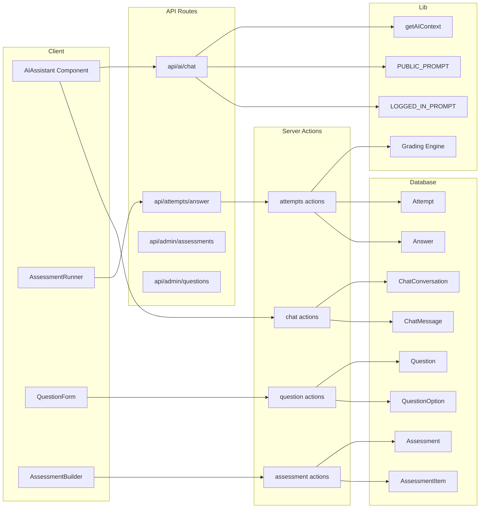

# Requirements

## Overview
This plan delivers two major features:
1. **Chat Persistence** — Unify the existing `PublicChatbot` and `StudentChatbot` into a single `AIAssistant` component that persists chat history for logged-in users.
2. **Assessment Engine Extension** — Extend the existing assessment system with a Question Bank, grading engine, analytics, and improved student runner.

## Goals
- AI assistant adapts to public vs logged-in mode with different greetings, prompts, and suggestions
- Chat history survives page reloads for logged-in users
- Admins can manage a reusable question bank
- Pure grading engine with full unit test coverage
- Students take assessments with timer, auto-save, and offline support
- Admins can grade essays and view analytics

## Scope

### In Scope
- Unify `PublicChatbot` + `StudentChatbot` → single `AIAssistant` component
- Add `ChatConversation` + `ChatMessage` Prisma models
- Update `/api/ai/chat` endpoint with mode branching + persistence
- Add `QuestionOption` normalized model (extend existing `Question`)
- Create `lib/assessment/grader.ts` with unit tests
- Admin question bank pages (CRUD + duplicate)
- Assessment builder with drag-drop reorder
- Student assessment runner with timer + offline
- Manual essay grading + analytics pages
- Extend existing admin assessment pages

### Out of Scope
- Google Sheets sync (optional, Phase 12F — deferred)
- External form integrations beyond what exists
- Proctoring features (camera, fullscreen enforcement)
- Migration of existing Question JSON data to normalized schema

## User Stories
- As a **visitor**, I want to chat with the AI about the platform without signing in
- As a **student**, I want my chat history to persist across sessions
- As an **admin**, I want to create and manage questions in a reusable bank
- As an **admin**, I want to build assessments by selecting questions
- As a **student**, I want to take assessments with a timer and see results
- As an **admin**, I want to grade essays and view assessment analytics

# Technical Design

## Current State

### AI Assistant (Existing)
- `components/ai/PublicChatbot.tsx` — floating chat for visitors, calls `/api/ai/public`
- `components/ai/StudentChatbot.tsx` — floating chat for students, calls `/api/ai/student`
- `lib/ai/prompts.ts` — `buildPublicPrompt()` + `buildStudentPrompt()` (dynamic, fetches data)
- `lib/ai/openrouter.ts` — OpenRouter API client (free models)
- `app/api/ai/public/route.ts` — public endpoint, no auth
- `app/api/ai/student/route.ts` — student endpoint, requires auth, fetches attempts/courses/tutors
- `app/layout.tsx` — renders `<PublicChatbot />` globally
- `app/(dashboard)/student/layout.tsx` — renders `<StudentChatbot />` for students

### Assessment System (Existing)
- `Assessment` model with `type`, `mode` (GOOGLE_FORM/NATIVE), `liveStatus`
- `Question` model (scoped to Assessment, options stored as JSON)
- `AssessmentAttempt` model with answers as JSON
- `FormResponse` model for external forms
- Admin pages at `/admin/assessments/` with list, create, edit

### Key Decision: Extend, Not Replace
We will **extend** the existing assessment models rather than replace them. The existing `Question.options` (JSON) will remain for backward compatibility. New features (Question Bank, grading engine) will work alongside existing models.

## Proposed Changes

### Part 1: Chat Persistence

#### 1.1 Prisma Schema Changes
Add to `prisma/schema.prisma`:
- `ChatConversation` model (userId, title, mode, isArchived, timestamps)
- `ChatMessage` model (conversationId, role, content, isError, tokensUsed, metadata)
- Add reverse relation to `User`: `chatConversations ChatConversation[]`

#### 1.2 Unified AIAssistant Component
Create `components/ai/ai-assistant.tsx`:
- Single component that detects auth mode via `useUser()` from Clerk
- Accepts optional props: `userFirstName`, `userRole`, `userInstitution`
- Different greeting, suggestions, and placeholder per mode
- Header shows "Public" or "Logged in · [Institution]"
- Persists conversationId in localStorage (`ai:last-conversation-id`)
- On open: loads messages from server if logged-in
- On send: creates conversation if needed, persists messages
- On reset: creates new conversation (logged-in) or clears state (public)

Remove:
- `components/ai/PublicChatbot.tsx`
- `components/ai/StudentChatbot.tsx`
- `components/ai/AIChat.tsx`
- `components/ai/AIInsightsCard.tsx`
- `components/ai/StudentChatbot.tsx`

#### 1.3 Unified API Route
Create `app/api/ai/chat/route.ts`:
- Single endpoint that calls `getAIContext()` to determine mode
- Uses `PUBLIC_PROMPT` or `LOGGED_IN_PROMPT` (with template replacement)
- Persists messages for logged-in users (fire-and-forget, never fails the request)
- Returns `{ content, mode, tokensUsed }`

Remove:
- `app/api/ai/public/route.ts`
- `app/api/ai/student/route.ts`

#### 1.4 Context + Prompts
- `lib/ai/context.ts` — `getAIContext()` server function (auth check → user lookup)
- `lib/ai/prompts/public.ts` — `PUBLIC_PROMPT` constant
- `lib/ai/prompts/logged-in.ts` — `LOGGED_IN_PROMPT` template
- Keep `lib/ai/prompts.ts` for backward compat (insights feature)

#### 1.5 Layout Updates
- `app/layout.tsx` — remove `<PublicChatbot />`, add `<AIAssistant />` (no props = public)
- `app/(dashboard)/student/layout.tsx` — replace `<StudentChatbot />` with `<AIAssistant userFirstName={...} />`
- `app/(dashboard)/admin/layout.tsx` — add `<AIAssistant />` for admins

#### 1.6 Server Actions
Create `lib/actions/chat.ts`:
- `listConversations()`, `getConversation()`, `createConversation()`
- `appendMessages()`, `renameConversation()`, `archiveConversation()`
- `deleteConversation()`, `deleteAllConversations()`
- All require auth, verify ownership

### Part 2: Assessment Engine Extension

#### 2.1 Schema Extensions
Add to `prisma/schema.prisma`:
- `QuestionOption` model (normalized options, replaces JSON storage for new questions)
- `AssessmentItem` model (junction table for Assessment ↔ Question with order)
- `Answer` model (normalized answers, replaces JSON in AssessmentAttempt)
- Add `FILL_IN_BLANK`, `MATCHING`, `NUMERIC` to `QuestionType` enum
- Add `PRACTICE` to `AssessmentType` enum
- Add `AttemptStatus` enum
- Add `AssessmentSource` enum (NATIVE, GOOGLE_FORM, MICROSOFT_FORM, EXTERNAL_LINK)

#### 2.2 Grading Engine
Create `lib/assessment/grader.ts`:
- Pure TypeScript, no dependencies
- `gradeAnswer()` — grades a single answer by question type
- `gradeAttempt()` — grades full attempt, returns score/percentage
- Supports: MCQ, T/F, Fill-in-blank, Numeric (with tolerance), Matching, Essay (returns null)

Create `lib/assessment/grader.test.ts`:
- 25+ test cases covering all question types

#### 2.3 Server Actions
- `lib/actions/questions.ts` — CRUD for questions (admin only)
- `lib/actions/assessments.ts` — CRUD for assessments (admin only)
- `lib/actions/attempts.ts` — start/save/submit attempt (student)

#### 2.4 Admin Pages
- `app/admin/questions/page.tsx` — question bank list
- `app/admin/questions/new/page.tsx` + `[id]/edit/page.tsx` — question form
- `app/admin/questions/_components/question-form.tsx` — dynamic form by type
- Extend `app/(dashboard)/admin/assessments/` with builder features

#### 2.5 Student Pages
- `app/(dashboard)/assessments/page.tsx` — student assessment list
- `app/(dashboard)/assessments/[id]/page.tsx` — assessment runner
- `app/(dashboard)/assessments/[id]/result/page.tsx` — result page

#### 2.6 Analytics + Grading
- `app/admin/assessments/[id]/grading/page.tsx` — manual essay grading
- `app/admin/assessments/[id]/analytics/page.tsx` — assessment analytics

## Architecture Diagram



## File Structure

### New Files
```
lib/
  ai/
    context.ts              (AI context detector)
    prompts/
      public.ts             (PUBLIC_PROMPT)
      logged-in.ts          (LOGGED_IN_PROMPT)
  actions/
    chat.ts                 (chat server actions)
    questions.ts            (question CRUD)
    assessments.ts          (assessment CRUD)
    attempts.ts             (attempt actions)
  assessment/
    grader.ts               (grading engine)
    grader.test.ts          (unit tests)
  validations/
    assessment.ts           (Zod schemas)

components/
  ai/
    ai-assistant.tsx        (unified AI assistant)

app/
  api/
    ai/
      chat/route.ts         (unified chat endpoint)
    attempts/
      answer/route.ts       (offline sync)
  admin/
    questions/
      page.tsx              (question bank list)
      new/page.tsx          (create question)
      [id]/edit/page.tsx    (edit question)
      _components/
        question-form.tsx   (dynamic form)
        question-preview.tsx
    assessments/
      [id]/
        grading/page.tsx    (essay grading)
        analytics/page.tsx  (analytics)
  (dashboard)/
    assessments/
      page.tsx              (student list)
      [id]/
        page.tsx            (runner)
        result/page.tsx     (results)
        _components/
          assessment-runner.tsx
          question-renderer.tsx
          timer.tsx
```

### Modified Files
- `prisma/schema.prisma` — add ChatConversation, ChatMessage, QuestionOption, AssessmentItem, Answer
- `app/layout.tsx` — replace PublicChatbot with AIAssistant
- `app/(dashboard)/student/layout.tsx` — replace StudentChatbot with AIAssistant
- `app/(dashboard)/admin/layout.tsx` — add AIAssistant

### Deleted Files
- `components/ai/PublicChatbot.tsx`
- `components/ai/StudentChatbot.tsx`
- `components/ai/AIChat.tsx`
- `components/ai/AIInsightsCard.tsx`
- `app/api/ai/public/route.ts`
- `app/api/ai/student/route.ts`

## Risks
- **Data migration**: Existing Question.options (JSON) won't migrate to QuestionOption automatically. Old assessments continue to work; new questions use normalized model.
- **OpenRouter vs OpenAI**: The issue specifies OpenAI SDK, but the app uses OpenRouter. We'll keep OpenRouter for consistency.
- **Breaking changes**: Removing old API routes may break bookmarks. We'll add redirects.
- **Large scope**: This is a big change. We'll deliver in small stages with validation after each.

# Testing

## Validation Approach
After each deliverable:
1. `npx tsc --noEmit` — type check
2. `npm run lint` — lint check
3. `npm run build` — build check
4. `npm run test` — unit tests

## Key Scenarios

### Chat Persistence
- Send message → reload → message persists
- Close tab → reopen → conversation loads
- "New conversation" → fresh greeting, old conversation in history
- Public user → no persistence (session-only)
- ESC closes panel, messages persist

### Assessment Engine
- Grader: correct/wrong for each question type
- Admin: create question of each type, edit, duplicate, delete
- Admin: build assessment, add/remove/reorder questions, publish
- Student: start assessment, answer questions, submit, view result
- Student: timer auto-submits at 0
- Admin: grade essay, see analytics

## Edge Cases
- Chat: rate limiting, network offline, empty responses
- Assessment: max attempts exceeded, assessment not published, institution mismatch
- Security: user cannot read another user's chat or assessment answers
- Grading: essay returns null (manual), matching with partial answers

# Data Models

### ChatConversation
```prisma
model ChatConversation {
  id            String   @id @default(cuid())
  userId        String
  user          User     @relation(fields: [userId], references: [id], onDelete: Cascade)
  title         String   @default("New conversation")
  mode          String   // 'PUBLIC' | 'LOGGED_IN'
  isArchived    Boolean  @default(false)
  lastMessageAt DateTime @default(now())
  createdAt     DateTime @default(now())
  updatedAt     DateTime @updatedAt
  messages      ChatMessage[]
  @@index([userId, lastMessageAt])
  @@index([userId, isArchived])
}
```

### ChatMessage
```prisma
model ChatMessage {
  id             String   @id @default(cuid())
  conversationId String
  conversation   ChatConversation @relation(fields: [conversationId], references: [id], onDelete: Cascade)
  role           String   // 'user' | 'assistant'
  content        String   @db.Text
  isError        Boolean  @default(false)
  tokensUsed     Int?
  metadata       Json?
  createdAt      DateTime @default(now())
  @@index([conversationId, createdAt])
}
```

### QuestionOption (new)
```prisma
model QuestionOption {
  id        String   @id @default(cuid())
  questionId String
  question  Question @relation(fields: [questionId], references: [id], onDelete: Cascade)
  text      String   @db.Text
  isCorrect Boolean  @default(false)
  order     Int
  @@index([questionId])
}
```

### AssessmentItem (new)
```prisma
model AssessmentItem {
  id             String     @id @default(cuid())
  assessmentId   String
  assessment     Assessment @relation(fields: [assessmentId], references: [id], onDelete: Cascade)
  questionId     String
  question       Question   @relation(fields: [questionId], references: [id], onDelete: Restrict)
  order          Int
  pointsOverride Int?
  @@unique([assessmentId, questionId])
  @@index([assessmentId])
}
```

### Answer (new)
```prisma
model Answer {
  id               String   @id @default(cuid())
  attemptId        String
  attempt          AssessmentAttempt @relation(fields: [attemptId], references: [id], onDelete: Cascade)
  questionId       String
  question         Question @relation(fields: [questionId], references: [id], onDelete: Cascade)
  selectedOptionId String?
  textAnswer       String?  @db.Text
  numericAnswer    Float?
  matchingAnswer   Json?
  isCorrect        Boolean?
  pointsEarned     Float?
  feedback         String?  @db.Text
  answeredAt       DateTime @default(now())
  updatedAt        DateTime @updatedAt
  @@unique([attemptId, questionId])
  @@index([attemptId])
}
```

### Grading Engine Signature
```typescript
export function gradeAnswer(
  question: QuestionWithOptions,
  answer: Partial<AnswerInput>
): GradeResult | null;

export function gradeAttempt(items: Array<{
  question: QuestionWithOptions;
  answer: Partial<AnswerInput>;
}>): {
  score: number;
  totalPoints: number;
  percentage: number;
  needsManualGrading: boolean;
};
```

# Delivery Steps

### ✓ Step 1: 1. Prisma schema + chat persistence foundation
Add ChatConversation, ChatMessage, QuestionOption, AssessmentItem, Answer models to schema. Run migration. Create lib/ai/context.ts with getAIContext(). Create prompt files (public.ts, logged-in.ts). Create grading engine with tests.
- Update prisma/schema.prisma with all new models and enum changes
- Run npx prisma migrate dev --name add_chat_and_assessment_extensions
- Create lib/ai/context.ts — getAIContext() returns mode + user data
- Create lib/ai/prompts/public.ts — PUBLIC_PROMPT constant
- Create lib/ai/prompts/logged-in.ts — LOGGED_IN_PROMPT template
- Create lib/assessment/grader.ts — pure grading logic
- Create lib/assessment/grader.test.ts — 25+ test cases
- Run tsc + lint + build + test

### * Step 2: 2. Unified AIAssistant component + API route
Create the unified AIAssistant component replacing PublicChatbot and StudentChatbot. Create unified /api/ai/chat route. Create chat server actions.
- Create components/ai/ai-assistant.tsx — unified component with mode detection
- Create app/api/ai/chat/route.ts — unified endpoint with mode branching + persistence
- Create lib/actions/chat.ts — server actions (list, get, create, append, rename, archive, delete)
- Update app/layout.tsx — replace PublicChatbot with AIAssistant
- Update app/(dashboard)/student/layout.tsx — replace StudentChatbot with AIAssistant
- Update app/(dashboard)/admin/layout.tsx — add AIAssistant
- Delete old components and API routes
- Run tsc + lint + build

### ✓ Step 3: 3. Admin question bank
Build the admin question bank: list page, create/edit form, and server actions for question CRUD.
- Create lib/actions/questions.ts — server actions (create, update, delete, duplicate, list, get)
- Create app/admin/questions/page.tsx — question bank list with filters
- Create app/admin/questions/new/page.tsx — create question
- Create app/admin/questions/[id]/edit/page.tsx — edit question
- Create app/admin/questions/_components/question-form.tsx — dynamic form by type
- Create app/admin/questions/_components/question-preview.tsx — live preview
- Run tsc + lint + build

### ✓ Step 4: 4. Assessment builder extension
Extend existing admin assessment pages with question selection, reorder, and settings.
- Create lib/validations/assessment.ts — Zod schemas
- Create lib/actions/assessments.ts — server actions (create, update, delete, publish, add/remove/reorder questions)
- Extend app/(dashboard)/admin/assessments/ with builder UI
- Create assessment builder with drag-drop (using existing patterns)
- Add question picker dialog with search + filters
- Run tsc + lint + build

### ✓ Step 5: 5. Student assessment runner
Build the student-facing assessment experience: list, runner with timer, and result page.
- Create lib/actions/attempts.ts — server actions (startAttempt, saveAnswer, submitAttempt, getAssessmentForStudent, getAttemptResult)
- Create app/(dashboard)/assessments/page.tsx — student assessment list
- Create app/(dashboard)/assessments/[id]/page.tsx — assessment runner page
- Create app/(dashboard)/assessments/[id]/_components/assessment-runner.tsx — client runner with timer, auto-save
- Create app/(dashboard)/assessments/[id]/_components/question-renderer.tsx — renders by type
- Create app/(dashboard)/assessments/[id]/_components/timer.tsx — countdown timer
- Create app/(dashboard)/assessments/[id]/result/page.tsx — result display
- Run tsc + lint + build

### ✓ Step 6: 6. Manual grading + analytics
Build admin essay grading interface and assessment analytics dashboard.
- Create app/admin/assessments/[id]/grading/page.tsx — lists attempts needing grading, essay grading view
- Create app/admin/assessments/[id]/analytics/page.tsx — attempt stats, per-question difficulty, distribution
- Add gradeEssayAnswer server action
- Add getAssessmentAnalytics server action
- Wire notifications (grade posted → student, essay needs grading → admin)
- Run tsc + lint + build
- Final verification: test full flow end-to-end