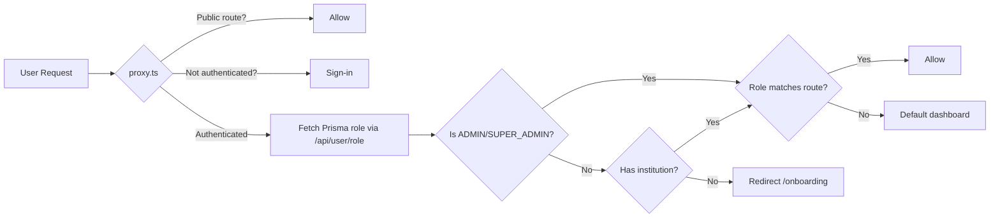
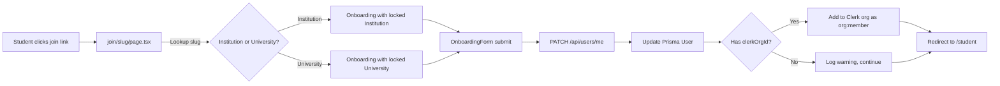

# Requirements

### Overview
Finalize the "Prisma is the Boss" authentication and onboarding architecture. Most of the infrastructure already exists, but there are critical gaps to close:
1. **Prisma-first auth is already in place** — `proxy.ts` and `lib/auth.ts` read roles from Prisma only. No changes needed.
2. **Magic join link flow exists** — `app/join/[slug]/page.tsx` → onboarding → `/api/users/me` PATCH. But Clerk org membership is not created for University-type joins.
3. **Middleware doesn't enforce onboarding** — Un-onboarded users can access `/student` without being redirected to `/onboarding` at the proxy level.
4. **Admin join link display exists** — Settings page already shows the join link with a copy button.

### Scope

**In Scope:**
- Fix onboarding form to create Clerk org membership for **both** Institution and University join types (currently only Institution works).
- Add onboarding enforcement in `proxy.ts` — redirect un-onboarded users without an institution to `/onboarding`.
- Ensure the `joinUniversity` flow adds users to the Clerk organization as `org:member`.
- Verify all dashboard layouts use Prisma-first role checks (already done, just verify).

**Out of Scope:**
- Creating new pages (join, onboarding, and settings pages already exist).
- Refactoring `proxy.ts` or `lib/auth.ts` (already Prisma-first).
- Changing the Prisma schema (all fields already exist).

### Functional Requirements

1. **Magic join link** must work for both Institution and University types, creating Clerk org membership in both cases.
2. **Un-onboarded users** must be redirected to `/onboarding` when accessing protected routes, not just `/student`.
3. **Admin settings** must display the join link with a copy button (already works).
4. **Role-based routing** must read from Prisma only, with no Clerk org role dependency (already works).

# Technical Design

### Current Implementation

**What already works:**
- `proxy.ts` — Prisma-first auth via `/api/user/role`. Role mismatches redirect to the default dashboard.
- `lib/auth.ts` — `requireAuth()` and `getAuthUser()` read `user.role` from Prisma only.
- `app/join/[slug]/page.tsx` — Resolves slug to Institution or University, redirects to `/onboarding`.
- `app/onboarding/page.tsx` + `OnboardingForm` — Renders the form, submits via PATCH `/api/users/me`.
- `app/api/users/me/route.ts` PATCH — Updates user profile, creates Clerk org membership **for Institution only** (lines 60-88).
- `app/(dashboard)/admin/settings/settings-client.tsx` — Displays join link with copy button.
- `app/(dashboard)/student/layout.tsx` — Redirects to `/onboarding` if profile is incomplete.

**What's missing:**
1. **University-type joins don't create Clerk org membership.** The PATCH handler (lines 69-74) skips Clerk sync for University joins with a warning.
2. **Proxy doesn't enforce onboarding.** An un-onboarded user with `STUDENT` role can access `/student` at the proxy level — only the layout catches it.

### Key Decisions

1. **Keep the existing flow architecture** — The join → onboarding → PATCH `/api/users/me` pattern already implements the "Magic Join Link" flow. No separate `joinUniversity` server action needed.

2. **Fix Clerk org membership for University joins** — When a user joins via a University slug, check if the University has an associated Institution with a `clerkOrgId` and add the user to that org.

3. **Add onboarding check in proxy.ts** — After the role check, verify the user has completed onboarding (has `institutionId` or `universityId` in Prisma). If not, redirect to `/onboarding`. ADMIN/SUPER_ADMIN are exempt.

4. **No schema changes needed** — All required fields already exist in the schema.

### Proposed Changes

#### 1. Modified: `app/api/users/me/route.ts`

- Fix the University join path to also create Clerk org membership.
- When `body.universityId` is set, look up the University to check if it has programmes linked to an Institution with a `clerkOrgId`.
- If no Clerk org is found, log a warning but don't fail the onboarding.

#### 2. Modified: `proxy.ts`

- Add an onboarding enforcement check after authentication.
- If the user's Prisma record has no `institutionId` and no `universityId` (and is not an ADMIN/SUPER_ADMIN), redirect to `/onboarding`.

#### 3. Verify: Dashboard layouts

- Confirm all layouts use `requireAuth()` with correct role arrays. No changes expected.

### File Structure

| Action | File |
|--------|------|
| **Modify** | `app/api/users/me/route.ts` (fix University Clerk org sync) |
| **Modify** | `proxy.ts` (add onboarding enforcement) |
| **Verify** | `app/(dashboard)/admin/layout.tsx` |
| **Verify** | `app/(dashboard)/tutor/layout.tsx` |
| **Verify** | `app/(dashboard)/lecturer/layout.tsx` |
| **Verify** | `app/(dashboard)/student/layout.tsx` |

### Architecture Diagram

# Testing

### Validation Approach

Since Node.js is unavailable in this environment, validation will be done by reviewing code against existing patterns.

### Key Scenarios

1. **University join creates Clerk membership** — A user joining via a University slug is added to the Clerk org if the University has an associated Institution with `clerkOrgId`.
2. **Onboarding enforcement in proxy** — An un-onboarded STUDENT accessing `/student` is redirected to `/onboarding` at the proxy level.
3. **ADMIN bypasses onboarding** — An ADMIN user without an institution can still access `/admin`.
4. **Existing Institution join still works** — No regression for the Institution-type join flow.
5. **Dashboard layouts use correct roles** — All layouts call `requireAuth()` with the right role arrays.

### Edge Cases

- User joins via University with no associated Institution — onboarding succeeds but no Clerk org membership is created (warning logged).
- User with `onboarded=true` but no institution — should not be redirected to `/onboarding` again.
- ADMIN/SUPER_ADMIN with no institution — should access `/admin` without onboarding.

# Delivery Steps

### ✓ Step 1: Fix University Clerk org sync in onboarding
Update `app/api/users/me/route.ts` so University-type joins also create Clerk org membership.
- In the PATCH handler, when `body.universityId` is set, look up the University's programmes to find an associated Institution with a `clerkOrgId`.
- If found, call `addUserToClerkOrg()` with the user's Clerk ID and the Institution's `clerkOrgId` as role `org:member`.
- If no `clerkOrgId` is found, log a warning but don't fail the onboarding.
- This ensures the double-write rule: every join updates both Clerk and Prisma.

### ✓ Step 2: Add onboarding enforcement in proxy.ts
Update `proxy.ts` to redirect un-onboarded users to `/onboarding`.
- Extend `/api/user/role` to also return whether the user has an institution (or create a lightweight check).
- After the role check in proxy, if the user is not ADMIN/SUPER_ADMIN and has no institution/university, redirect to `/onboarding`.
- `/onboarding` is already in the public route patterns (line 14).

### ✓ Step 3: Verify dashboard layouts use correct roles
Confirm all dashboard layouts call `requireAuth()` with the correct role arrays.
- `app/(dashboard)/admin/layout.tsx` — `requireAuth(['ADMIN', 'SUPER_ADMIN'])` already correct.
- `app/(dashboard)/tutor/layout.tsx` — `requireAuth(['TUTOR', 'LECTURER'])` already correct.
- `app/(dashboard)/lecturer/layout.tsx` — `requireAuth(['LECTURER'])` already correct.
- `app/(dashboard)/student/layout.tsx` — `requireAuth(['STUDENT'])` already correct.
- No code changes expected — just verification.