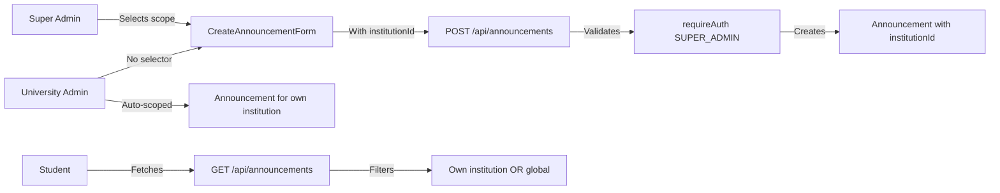
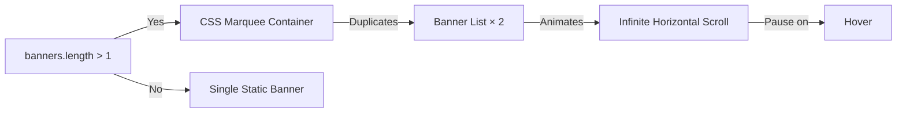

# Requirements

## Previously Completed Tasks

### ✓ Carousel Speeds, Grading Cleanup, RBAC Audit, Color Modernization, Super Admin Privileges
All previously completed — see git history for details.

---

## New Task 1: Offline-First Architecture (PWA)

### Overview
Zambian students often have unstable internet or run out of data. The app must work seamlessly when they lose connection. The goal is to make the dashboard, courses, and videos usable offline with cached content.

### Functional Requirements
1. **Service Worker & PWA**: Already configured via `next-pwa` in `next.config.ts`. Needs enhanced caching strategies for dashboard UI shells and data fallback.
2. **Global Offline Detector**: A sticky banner at the top of the screen showing "🔴 You are offline. Viewing cached content." when disconnected, and "🟢 Back online. Syncing data..." when reconnected.
3. **Offline Fallback Page**: If a user navigates to a page they haven't visited while offline, show a friendly `/offline` page instead of a crash.
4. **Data Caching**: If `getCourses` or `getPastPapers` fails due to no network, return the last cached data from IndexedDB (using the already-installed `idb` package).

### Out of Scope
- Full offline data mutation (creating/editing while offline and syncing later).
- Caching video streaming content for offline playback.

---

## New Task 2: Super Admin Global Posting

### Overview
The Super Admin must be able to post Announcements to any specific university, or to all universities globally. University Admins can only post to their own university.

### Functional Requirements
1. **Announcement Scoping**: The `Announcement` model currently has no `institutionId` field. Add optional `institutionId` so announcements can be scoped to a specific university or left `null` for global reach.
2. **Super Admin Posting UI**: When creating an announcement, the Super Admin should see a dropdown to select "All Universities" or a specific university. University Admins always post to their own university (no dropdown).
3. **Fetching Rule**: Student-facing queries must fetch announcements where `institutionId` matches their university OR `institutionId` is `null` (global).
4. **Banner System**: Already supports multi-institution targeting via `BannerScope` + `BannerTarget`. No changes needed.

---

## New Task 3: Infinite Banner Carousel

### Overview
On the student dashboard, if there are multiple active banners, they should display in a smooth, infinite horizontal sliding marquee (right to left, then back) — similar to the university logos carousel on the homepage.

### Functional Requirements
1. **Infinite Marquee**: Replace the current index-based rotation in `banner-carousel.tsx` with a CSS-based infinite marquee animation when there are multiple banners.
2. **Smooth Animation**: Continuous horizontal scroll, pausing on hover.
3. **Single Banner**: If only one banner exists, show it normally (no animation).
4. **Dark Mode Compatible**: All styles must work in dark mode.

---

## Pending Tasks (From Previous Plan)

### Step 4: Fix Sign-Up redirect and Onboarding Clerk org integration
### Step 5: Add course auto-assignment to tutor approval flow
### Step 6: Create Find-Tutor directory page for students
### Step 7: Verify Tutor CRUD course ownership checks

# Technical Design

## Task 1: Offline-First Architecture

### Current Implementation

**PWA Setup (`next.config.ts`)**: `next-pwa` is already configured with `dest: 'public'`, `register: true`, `skipWaiting: true`, disabled in development. This provides basic service worker caching.

**Dependencies**: `idb` (IndexedDB wrapper, v7.1.1) is already installed — perfect for caching API responses.

**Offline Detector**: No existing component.

**Offline Fallback Page**: No existing `/offline` page.

### Proposed Changes

**1. Enhanced PWA Caching (`next.config.ts`)**
- Add `builds` configuration to cache specific routes: `/dashboard`, `/student/courses`, `/student/videos`.
- Configure caching strategies:
  - Static assets (CSS, JS, fonts): `StaleWhileRevalidate`
  - UI shells: `NetworkFirst` with fallback to cache
  - Images (thumbnails): `CacheFirst`

**2. Offline Detector Component (`components/offline-detector.tsx`)**
- Client component that listens to `window.addEventListener('offline')` and `window.addEventListener('online')`.
- Renders a sticky banner at the top of the screen.
- Offline state: `🔴 You are offline. Viewing cached content.` (red background).
- Online state: `🟢 Back online. Syncing data...` (green background, auto-hides after 3 seconds).
- Add to `DashboardLayout.tsx` so it appears on all dashboard pages.

**3. Offline Fallback Page (`app/offline/page.tsx`)**
- A simple, self-contained page with a friendly message, an icon, and a "Try Again" button.
- Ensure this page is cached by the service worker (add to `skipWaiting` routes).

**4. Data Caching Wrapper (`lib/offline-cache.ts`)**
- Create a utility that wraps API fetches with IndexedDB fallback using `idb`.
- When a fetch succeeds, store the response in IndexedDB.
- When a fetch fails (network error), return the cached data.
- Apply to: `getCourses`, `getPastPapers`, `getVideos`, `getAnnouncements`.

### Architecture Diagram

```mermaid
graph LR
  A[User loses connection] --> B[Offline Detector]
  B -->|Shows banner| C[Sticky Top Banner]
  A --> D[API Fetch fails]
  D --> E[offline-cache wrapper]
  E -->|Reads from| F[IndexedDB via idb]
  F -->|Returns cached| G[Component renders cached data]
  H[New page while offline] --> I[Service Worker]
  I -->|Fallback| J[/offline page]
```

---

## Task 2: Super Admin Global Posting

### Current Implementation

**Announcement Model (`schema.prisma` lines 247-258)**: No `institutionId` field. All announcements are global.

**Banner System**: Already fully supports multi-institution targeting via `BannerScope` enum (GLOBAL/ALL/SPECIFIC) and `BannerTarget` junction table. Server actions in `lib/actions/banner.ts` already have Super Admin bypass logic.

**Announcement API (`app/api/announcements/route.ts`)**: `requireAuth(['ADMIN', 'SUPER_ADMIN'])` — both can create. No institution scoping.

**Announcement UI (`CreateAnnouncementForm.tsx`)**: Simple form with title and content. No institution selector.

### Proposed Changes

**1. Schema Update (`prisma/schema.prisma`)**
- Add `institutionId String?` to the `Announcement` model.
- Add `institution Institution? @relation(fields: [institutionId], references: [id], onDelete: SetNull)`.
- Run `prisma db push` to apply.

**2. Server Action Update (`lib/actions/banner.ts` or a new `lib/actions/announcement.ts`)**
- Update `createAnnouncement` to accept optional `institutionId`.
- Add authorization: ADMIN can only set `institutionId` to their own institution; SUPER_ADMIN can set any or `null`.
- Update the announcement fetch to include institution scoping for students.

**3. API Route Update (`app/api/announcements/route.ts`)**
- Update POST to accept `institutionId` in the request body.
- Add institution validation: if ADMIN, enforce `institutionId === admin.institutionId`.
- Update GET to filter: students see announcements where `institutionId === their.institutionId OR institutionId === null`.

**4. UI Update (`CreateAnnouncementForm.tsx`)**
- Add an institution dropdown when the user is SUPER_ADMIN.
- Options: "All Universities" (null) or select a specific university.
- Hide the dropdown for ADMIN (always posts to their own university).

### Architecture Diagram



---

## Task 3: Infinite Banner Carousel

### Current Implementation

**`banner-carousel.tsx`**: Uses `currentIndex` state + `setInterval` (5s) to rotate between banners. Shows prev/next arrows and dot indicators. Single banner at a time.

**Homepage UniversitiesCarousel**: Uses CSS `animate-marquee` class with `animation: marquee 20s linear infinite` for infinite horizontal scrolling.

### Proposed Changes

**1. Replace Index-Based Rotation with CSS Marquee**
- When there are multiple banners, render them in a horizontal flex container.
- Duplicate the banner list to create a seamless loop (standard marquee technique).
- Apply CSS animation similar to the homepage's `.animate-marquee`.
- Pause on hover.

**2. Keep Single Banner as Normal**
- If only one banner, render it as a static card (no animation).

**3. Remove Navigation Controls**
- Remove prev/next arrows and dot indicators — the marquee is continuous.

**4. CSS Keyframes**
- Add a new `@keyframes banner-marquee` animation in the component's style or global CSS.
- Duration: 30s for a smooth, non-distracting scroll.

### Architecture Diagram



---

## Pending Tasks (From Previous Plan)

### Step 4: Fix Sign-Up redirect and Onboarding Clerk org integration
### Step 5: Add course auto-assignment to tutor approval flow
### Step 6: Create Find-Tutor directory page for students
### Step 7: Verify Tutor CRUD course ownership checks

# Delivery Steps

### ✓ Step 1: Increase carousel speeds in HomePageClient.tsx
Reduce the animation durations for both carousels. (Completed)

### ✓ Step 2: Remove AccordionTable and Source Note from Grading System
Clean up the Zambian University Grading System section. (Completed)

### ✓ Step 3: Generate RBAC Security Audit Report
Comprehensive Markdown verification report for all 5 roles. (Completed)

### ✓ Step 4: Create Offline Detector and Offline Fallback Page
Build the offline detection system and fallback page.
- Create `components/offline-detector.tsx` — client component that listens to `online`/`offline` events and shows a sticky banner.
- Add the detector to `DashboardLayout.tsx` so it appears on all dashboard pages.
- Create `app/offline/page.tsx` — a friendly offline fallback page with a "Try Again" button.
- Update `next.config.ts` PWA config to ensure the `/offline` page is cached by the service worker.

### ✓ Step 5: Add IndexedDB Data Caching for API Responses
Create a caching layer that returns cached data when the network is unavailable.
- Create `lib/offline-cache.ts` — a utility using the `idb` package (already installed) to cache and retrieve API responses.
- Wrap key data fetch functions (`getCourses`, `getPastPapers`, `getVideos`) with the cache wrapper.
- When a fetch succeeds, store in IndexedDB. When it fails, return cached data.

### ✓ Step 6: Add Institution Scoping to Announcements
Enable Super Admin to post announcements to specific universities or globally.
- Add `institutionId String?` and `institution` relation to the `Announcement` model in `prisma/schema.prisma`.
- Run `prisma db push` to apply the schema change.
- Update `app/api/announcements/route.ts` POST to accept `institutionId` and validate: ADMIN can only post to their institution, SUPER_ADMIN can post to any or globally.
- Update GET to filter: students see announcements where `institutionId === their.institutionId OR institutionId === null`.
- Update `CreateAnnouncementForm.tsx` to show an institution dropdown only for SUPER_ADMIN.

### ✓ Step 7: Convert Banner Carousel to Infinite Marquee
Replace the index-based rotation with a smooth, continuous CSS marquee.
- Update `components/banner-carousel.tsx` to render banners in a horizontal flex container with CSS marquee animation when multiple banners exist.
- Duplicate the banner list for seamless looping (standard marquee technique).
- Add `@keyframes banner-marquee` CSS animation (~30s duration, pause on hover).
- Keep single banner as a static card (no animation).
- Remove prev/next arrows and dot indicators.

### ✓ Step 8: Fix Sign-Up redirect and Onboarding Clerk org integration
Ensure new users are properly added to a Clerk organization during onboarding.
- `afterSignUpUrl="/onboarding"` is already set in `app/sign-up/[[...sign-up]]/page.tsx`.
- `onboarding-form.tsx` already calls `completeOnboarding` which uses `addUserToClerkOrg()` to add the user to the Clerk organization.
- Middleware (`proxy.ts`) already prevents infinite redirect loops — `/onboarding` is a public route, and the redirect check excludes `/onboarding` from the loop.

### ✓ Step 9: Add course auto-assignment to tutor approval flow
When an admin approves a tutor application, automatically assign the selected courses to the new tutor.
- Updated `approveTutorApplication` in `lib/actions/tutor-application.ts` to set `course.tutorId = tutor.id` for courses selected in the application's offerings.
- No schema changes needed — `Course.tutorId` already exists.

### ✓ Step 10: Create Find-Tutor directory page for students
Build a new page where students can browse and find tutors.
- Created `app/(dashboard)/student/find-tutor/page.tsx` with toggle for "My University" vs "All Universities".
- Created `getTutors()` server action in `lib/actions/tutor-directory.ts` that accepts `institutionId` filter.
- Built TutorCard component showing name, university, specialties, hourly rate, and "Book Session" button.
- Updated "Find Tutors" nav link in `DashboardLayout.tsx` to point to `/student/find-tutor`.

### ✓ Step 11: Verify Tutor CRUD course ownership checks
Audit and harden tutor upload/grading actions to enforce course ownership.
- Added `isResourceInFullScopeFromUser` scope check to `app/api/assignments/route.ts` POST endpoint.
- Added `isResourceInFullScopeFromUser` scope check to `app/api/quizzes/route.ts` POST endpoint.
- Verified that videos, lecture-slides, past-papers, and tests already had scope checks.
- All tutor-enabled endpoints now enforce course ownership via the scope system.

---

## New Task: Audience Targeting, Target Org Dropdown & Clerk Sync Fix

### Overview
Three interconnected tasks to finalize the Super Admin posting system and fix the Clerk organization sync bug:

1. **Target Organization Dropdown** — Hide the audience targeting dropdown from University Admins (they should always post to their own university). Show it only to Super Admins.
2. **Backend Security Guard** — Ensure the server action for creating banners and announcements strictly enforces that ADMIN users cannot spoof the target organization. Their posts are locked to their own institution.
3. **Clerk Sync Fix** — Add a "Sync" button on the `/admin/organizations` page so the Super Admin can manually create missing Clerk organizations for institutions showing "Not linked ⚠️".

### Scope

**In Scope:**
- `ScopeSelector` component — hide from ADMIN, show only to SUPER_ADMIN
- `createBanner` server action — enforce ADMIN cannot override target org (already in place, verify)
- `POST /api/announcements` — already enforces correctly, verify
- `CreateAnnouncementForm` — already hides dropdown from ADMIN, verify
- New `syncOrganizationToClerk` server action
- `/admin/organizations` page — add "Sync" button per institution

**Out of Scope:**
- Full audience targeting system (programme/year/course scoping) — that is a future enhancement
- Modifying the Announcement model to add audience fields
- Modifying the Banner model to add audience fields

---

### Current Implementation

**Banner System:**
- **Schema** (`prisma/schema.prisma` lines 1386-1431): `Banner` model with `BannerScope` enum (GLOBAL/ALL/SPECIFIC), `BannerTarget` junction table for multi-institution targeting, optional `institutionId` for backward compatibility.
- **Server Action** (`lib/actions/banner.ts` lines 230-294): `createBanner()` calls `requireAdminWithOrg()`, which returns `{admin, scope}`. If `!scope.isSuperAdmin` and scope is SPECIFIC, filters `institutionIds` to only the admin's own institution. **This is already correct.**
- **UI Form** (`components/banner-form.tsx`): Uses `ScopeSelector` component (line 271-282). The form doesn't check the user's role before showing the scope selector — it's always visible. **Needs fixing.**
- **ScopeSelector** (`app/admin/banners/_components/scope-selector.tsx`): Radio buttons for GLOBAL/ALL/SPECIFIC. Always visible to anyone who can access the banner form. **Needs fixing.**

**Announcement System:**
- **Schema** (`prisma/schema.prisma` lines 247-261): `Announcement` model with optional `institutionId` (null = global).
- **API Route** (`app/api/announcements/route.ts` lines 7-53): `POST` checks `role === 'SUPER_ADMIN'` — if true, uses provided `institutionId`; if ADMIN, ignores payload and uses author's own `institutionId`. **This is already correct.**
- **UI Form** (`components/CreateAnnouncementForm.tsx`): Checks `user.role === 'SUPER_ADMIN'` before showing the institution dropdown (line 96). **This is already correct.**

**Clerk Sync:**
- **`createClerkOrg`** (`lib/clerk-org.ts` lines 165-200): Creates a Clerk organization via API. Returns `{success, orgId}`.
- **`inviteAdmin`** (`lib/actions/institution-crud.ts` lines 363-417): Auto-creates Clerk org if missing before inviting an admin. This means the sync logic exists but only runs as a side effect of inviting an admin.
- **Organizations Page** (`app/(dashboard)/admin/organizations/page.tsx`): Displays institutions with "Linked ✅" or "Not linked ⚠️" status. **No action button to fix "Not linked" status. Needs fixing.**

---

### Key Decisions

1. **ScopeSelector visibility based on server-side role**: Pass `isSuperAdmin` prop to `BannerForm` from the server component, then conditionally render `ScopeSelector` only for Super Admins. This prevents frontend-only hiding that could be bypassed.

2. **Backend guard is already in place for banners**: The `createBanner` server action already restricts ADMIN to their own institution. No changes needed there — just verify.

3. **Dedicated `syncOrganizationToClerk` server action**: Create a new server action in `lib/actions/institution-crud.ts` that calls `createClerkOrg` and updates the Prisma record. This is idempotent — calling it on an already-linked institution is a no-op.

4. **Sync button on organizations page**: Add a "Sync" button next to each "Not linked" institution. On click, call the server action and revalidate the page.

---

### Proposed Changes

#### 1. Hide ScopeSelector from University Admins in Banner Form

**File: `components/banner-form.tsx`**
- Add an `isSuperAdmin` prop to `BannerForm`.
- Conditionally render the `ScopeSelector` section only when `isSuperAdmin` is true.
- When `isSuperAdmin` is false, set default scope to `'SPECIFIC'` with the admin's own institution pre-selected.

**File: The page that renders `BannerForm`** (need to find — likely `app/admin/banners/create/page.tsx` or similar)
- Fetch the user's role and pass `isSuperAdmin` to `BannerForm`.

#### 2. Verify Backend Guards (No Changes Expected)

**File: `lib/actions/banner.ts`** — `createBanner()` (lines 235-243)
- Already restricts ADMIN to their own institution. ✅ No changes needed.

**File: `app/api/announcements/route.ts`** — `POST` (lines 27-33)
- Already ignores `institutionId` from ADMIN. ✅ No changes needed.

#### 3. Add `syncOrganizationToClerk` Server Action

**File: `lib/actions/institution-crud.ts`**
- Add new server action `syncOrganizationToClerk(institutionId)` that:
  1. Calls `requireSuperAdmin()` to ensure only Super Admin can trigger.
  2. Fetches the institution from Prisma.
  3. If `clerkOrgId` is already set, return success (idempotent).
  4. Calls `createClerkOrg(institution.name, institution.slug)`.
  5. Updates the institution with `clerkOrgId` and `clerkOrgSlug`.
  6. Returns `{success, clerkOrgId}`.

#### 4. Add Sync Button to Organizations Page

**File: `app/(dashboard)/admin/organizations/page.tsx`**
- Add a "Sync" button in the Status column for institutions with `clerkOrgId === null`.
- The button triggers `syncOrganizationToClerk` via a form action.
- On success, revalidate the page to show the updated status.

---

### File Structure

```
Modified files:
  components/banner-form.tsx                    - Add isSuperAdmin prop, conditional ScopeSelector
  lib/actions/institution-crud.ts              - Add syncOrganizationToClerk server action
  app/(dashboard)/admin/organizations/page.tsx - Add Sync button per institution

To investigate:
  app/admin/banners/create/page.tsx (or similar) - Pass isSuperAdmin to BannerForm
```

---

### Testing

#### Key Scenarios
1. **ADMIN creates banner** → ScopeSelector hidden, banner targets admin's own institution.
2. **SUPER_ADMIN creates banner** → ScopeSelector visible, can choose GLOBAL/ALL/SPECIFIC.
3. **ADMIN spoofs banner payload** with another institution's ID → Backend blocks it, banner still targets admin's own institution.
4. **SUPER_ADMIN clicks Sync** on "Not linked" institution → Clerk org created, status changes to "Linked ✅".
5. **SUPER_ADMIN clicks Sync** on already-linked institution → No error, returns success.

#### Edge Cases
- Institution with no slug (required for Clerk org creation) — return a descriptive error.
- Clerk API returns 409 (org already exists) — treat as success, link the existing org.
- `CLERK_SECRET_KEY` not configured — return a clear error message.

---

### Delivery Steps for This Task

### ✓ Step 12: Add `syncOrganizationToClerk` server action and Sync button to Organizations page
The Super Admin can now manually sync institutions with Clerk from the `/admin/organizations` page.

- Add `syncOrganizationToClerk(institutionId)` server action in `lib/actions/institution-crud.ts`.
- The action requires SUPER_ADMIN role, fetches the institution, calls `createClerkOrg`, and updates Prisma.
- Add a "Sync" button in the Status column of `app/(dashboard)/admin/organizations/page.tsx` for institutions with `clerkOrgId === null`.
- Use a form action pattern to trigger the sync and revalidate on success.

### ✓ Step 13: Hide ScopeSelector from University Admins in Banner Form
The banner creation form now shows the audience targeting dropdown only to Super Admins.

- Add `isSuperAdmin` prop to `BannerForm` in `components/banner-form.tsx`.
- Conditionally render the `ScopeSelector` section only when `isSuperAdmin` is true.
- When not a Super Admin, default scope to `'SPECIFIC'` with the admin's own institution.
- Find the page that renders `BannerForm` and pass the `isSuperAdmin` prop from server-side role checking.
- Verify that the backend guard in `createBanner` still blocks spoofed requests (already in place).

### ✓ Step 14: Verify Announcement system and run build
Confirm the announcement system already enforces the correct guards and validate the entire build.

- Verify `CreateAnnouncementForm` already hides the dropdown from ADMIN (confirmed at line 96).
- Verify `POST /api/announcements` already ignores `institutionId` from ADMIN (confirmed at lines 27-33).
- Run `npx tsc --noEmit` to check for TypeScript errors.
- Run `npm run build` to validate the full build.
- Commit and push changes.

---

## New Task: Clerk Sync Fix, Bulk Sync, and PDF Reports

### ✓ Step 15: Fix `createInstitution` to auto-create Clerk org
The root cause of "Not linked ⚠️" — `createInstitution()` saves to Prisma but never creates the Clerk org.

- Update `createInstitution()` in `lib/actions/institution-crud.ts` to call `createClerkOrg()` after Prisma creation.
- Add try/catch with rollback: if Clerk creation fails, delete the Prisma record to avoid orphaned institutions.
- Update the Prisma record with `clerkOrgId` and `clerkOrgSlug` on success.

### ✓ Step 16: Add `syncAllOrgsToClerk` server action and "Sync All" button
Bulk sync all unlinked institutions to Clerk from the organizations page.

- Add `syncAllOrgsToClerk()` server action in `lib/actions/institution-crud.ts` — iterates all unlinked institutions and syncs each one.
- Add a "Sync All" button at the top of `app/(dashboard)/admin/organizations/page.tsx`.
- The button triggers the bulk sync and reloads the page on success.

### ✓ Step 17: Install jspdf and add PDF export for Institutions and Users
Generate professional PDF reports for the Super Admin.

- Installed `jspdf` and `jspdf-autotable` packages.
- Created API route `/api/export/institutions` that generates a PDF with institution details.
- Created API route `/api/export/users` that generates a PDF table of all users.
- Added "Export PDF" buttons to both the organizations page and the users page.

### ✓ Step 18: Build, verify, and push
- Run `npx tsc --noEmit` to check for TypeScript errors.
- Run `npm run build` to validate the full build.
- Commit and push all changes.