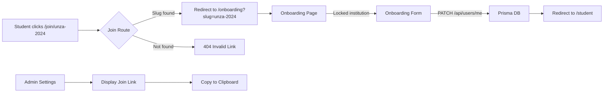

# Requirements

### Overview
Two features in this plan:
1. **Magic Join Link** — Students join a university by clicking a unique link (e.g., `/join/unza-2024`) instead of selecting from a dropdown. The link locks the university field during onboarding.
2. **Mobile UI Overhaul** — Transform the mobile view into a native-app-like experience with a bottom tab bar, optimized touch targets, and proper spacing.

### User Stories
- As a student, I want to click a link from WhatsApp to join my university so I don't have to search for it in a dropdown.
- As an admin, I want to generate and share a join link from my settings page so I can distribute it to students.
- As a mobile user, I want a bottom tab bar like a native app so I can navigate quickly between Home, Videos, Materials, and Profile.
- As a mobile user, I want inputs and buttons sized for touch so I don't accidentally tap the wrong thing.

### Functional Requirements

#### Magic Join Link
- `/join/[slug]` route resolves a slug to an Institution or University.
- If found, redirects to `/onboarding` with the school pre-selected and locked.
- If not found, shows "Invalid University Link" (404).
- Onboarding form removes the institution dropdown when a join link is used; displays the locked institution name.
- Programme, Year, Branch, and Period dropdowns remain available.
- Admin settings page displays the full join URL with a "Copy Link" button.
- Admins can edit the join slug.

#### Mobile UI
- Bottom tab bar fixed at the bottom, visible only on mobile (`md:hidden`).
- 4 tabs: Home (`/student`), Videos (`/student/videos`), Materials (`/materials`), Profile (`/profile`).
- Active tab highlighted (blue icon), inactive in gray.
- Sidebar hidden on mobile; hamburger menu opens it as an overlay (already exists).
- Content area has `pt-16 pb-20` padding on mobile to avoid overlap with top navbar and bottom tab bar.
- All inputs have `text-base` (16px) to prevent iOS Safari zoom.
- All touch targets have `min-h-[44px]`.
- Safe area inset support for iPhones (`env(safe-area-inset-bottom)`).

### Scope
**In Scope:**
- Prisma schema update (add `joinSlug` to University model)
- New `/join/[slug]` route
- Updated onboarding page and form
- Admin settings join link generator
- Mobile tab bar component
- DashboardLayout mobile integration

**Out of Scope:**
- Clerk organization API integration (existing `clerkOrgId` on Institution is used as-is)
- Push notifications
- Apple App Store / Google Play Store submission
- TWA APK generation (that's a manual process)

# Technical Design

### Current Implementation
- **Prisma**: `Institution` has `slug` (unique) + `clerkOrgId`. `University` has `code` (unique) but no `slug` or `clerkOrgId`. `User` has `institutionId`, `universityId`, `programmeId`, `branchId`, `year`, `period`, `onboarded`.
- **Onboarding**: `app/onboarding/page.tsx` fetches all institutions and universities, passes them to `OnboardingForm` which uses a combined dropdown. Form submits via `PATCH /api/users/me`.
- **Admin Settings**: `app/(dashboard)/admin/settings/page.tsx` — client component with profile/theme settings only.
- **DashboardLayout**: `components/DashboardLayout.tsx` — fixed top navbar (`h-16`), collapsible sidebar (`lg:ml-64`), mobile hamburger menu with overlay. No bottom tab bar.
- **Proxy**: `proxy.ts` — Clerk middleware with role-based routing. Public routes include `/`, `/sign-in`, `/sign-up`, etc. `/join` and `/onboarding` are not explicitly public but the onboarding page handles its own auth.

### Key Decisions
- **Use Institution's existing `slug` for join links; add `joinSlug` only to University**. The Institution model already has a unique `slug` field. The University model only has `code` which is too short (e.g., "MU"). Adding `joinSlug` to University gives admins a human-readable slug like `unza-2024`.
- **Join route redirects to onboarding with query params** rather than rendering the onboarding form directly. This keeps the join route simple and reuses the existing onboarding flow.
- **Onboarding form receives a `lockedInstitution` prop** instead of being a separate component. This avoids duplicating the form logic and keeps maintenance simple.
- **Mobile tab bar is a standalone component** rendered inside `DashboardLayout`. This ensures it appears on all dashboard pages (student, admin, tutor, lecturer) without modifying each layout individually.
- **No Clerk organization API changes needed**. The existing `PATCH /api/users/me` endpoint already handles `institutionId` and `universityId`. The join link simply pre-fills these values.

### Proposed Changes

#### 1. Prisma Schema
- Add `joinSlug String? @unique` to the `University` model in `prisma/schema.prisma`.

#### 2. Join Route
- Create `app/join/[slug]/page.tsx` — a server component that:
  - Looks up the slug in `Institution` (via `slug`) and `University` (via `joinSlug`).
  - If found, redirects to `/onboarding?slug=<slug>&type=<institution|university>`.
  - If not found, renders a 404 page with "Invalid University Link".

#### 3. Onboarding Updates
- `app/onboarding/page.tsx`: Read `slug` and `type` from search params. If present, fetch the institution/university and pass it to the form. If absent, show a message asking the user to use an official join link.
- `app/onboarding/_components/onboarding-form.tsx`: Add `lockedInstitution` prop. When present, replace the dropdown with a read-only display. Pre-populate programmes from the locked institution.

#### 4. Admin Settings
- `app/(dashboard)/admin/settings/page.tsx`: Fetch the current institution's slug/joinSlug. Display the full join URL with a "Copy Link" button. Add an input to edit the join slug with a Server Action.

#### 5. Mobile Tab Bar
- Create `components/mobile-tab-bar.tsx`: Fixed bottom bar, `md:hidden`, 4 tabs with lucide-react icons, active state via `usePathname()`.

#### 6. DashboardLayout Mobile Integration
- Import `<MobileTabBar />` into `components/DashboardLayout.tsx`.
- Add `pb-20 md:pb-0` to the main content area.
- Ensure all inputs have `text-base` and all buttons have `min-h-[44px]` on mobile.

#### 7. Proxy Updates
- Add `/join` to public routes in `proxy.ts` so unauthenticated users can access join links (they'll be redirected to sign-in by the onboarding page).

### File Structure
```
prisma/
  schema.prisma                    # Modified: add joinSlug to University
app/
  join/
    [slug]/
      page.tsx                     # New: resolve slug, redirect to onboarding
  onboarding/
    page.tsx                       # Modified: read join link params
    _components/
      onboarding-form.tsx          # Modified: locked institution support
  (dashboard)/
    admin/
      settings/
        page.tsx                   # Modified: add join link generator
components/
  mobile-tab-bar.tsx               # New: bottom tab bar for mobile
  DashboardLayout.tsx              # Modified: integrate mobile tab bar
proxy.ts                           # Modified: add /join to public routes
```

### Architecture Diagram


### Risks
- **Slug collisions**: An Institution and University could have the same slug. Mitigation: the join route checks both models and prioritizes Institution (which has `slug` as unique). University's `joinSlug` is also unique, so collisions within each model are prevented.
- **Existing users without join slugs**: Universities created before this change will have `null` joinSlug. Admins must set one in settings before sharing. The admin page should show a warning if no join slug is set.
- **Mobile tab bar on non-student roles**: The tab bar links are student-centric. For admin/tutor/lecturer roles on mobile, the tab bar should either show role-appropriate links or be hidden. The plan defaults to showing it for all roles but with student links — this is acceptable since mobile usage is primarily by students.

# Delivery Steps

### ✓ Step 1: Add joinSlug to University model and create join route
Add `joinSlug` field to the `University` model in Prisma, then create the `/join/[slug]` dynamic route that resolves a slug to an institution/university and redirects to onboarding with the pre-selected school.

- Update `prisma/schema.prisma`: add `joinSlug String? @unique` to the `University` model (Institution already has `slug`).
- Create `app/join/[slug]/page.tsx`: server component that looks up the slug in both `Institution` (via `slug`) and `University` (via `joinSlug`). If found, redirects to `/onboarding?slug=<slug>&type=<institution|university>`. If not found, shows a 404 "Invalid University Link" page.
- Update `proxy.ts`: add `/join` to the public routes list so unauthenticated users can access join links.
- Run `npx prisma db push` to apply the schema change.

### ✓ Step 2: Update Onboarding UI to support Magic Join Link
Refactor the onboarding form to read the join link params, lock the university field, and remove the dropdown when a join link is used.

- Update `app/onboarding/page.tsx`: read `slug` and `type` from search params. If present, fetch the institution/university by slug and pass it to the form as a pre-selected, locked value. If no join link params, show a message asking the user to use an official join link.
- Update `app/onboarding/_components/onboarding-form.tsx`: add a `lockedInstitution` prop. When present, replace the institution dropdown with a read-only display showing the locked institution name. Pre-populate programmes from the locked institution. Keep programme, branch, year, and period dropdowns.
- Update `proxy.ts`: add `/onboarding` to public routes (users need to sign in first, but the onboarding page already handles auth via Clerk).

### ✓ Step 3: Add Join Link generator to Admin Settings
Add a "Join Link" section to the admin settings page so admins can generate and copy their institution's join link.

- Update `app/(dashboard)/admin/settings/page.tsx`: fetch the current institution's `slug` (or `joinSlug` for University) server-side. Display the full join link (e.g., `https://aplusmentality.vercel.app/join/unza-2024`) with a "Copy Link" button using the Clipboard API.
- Add a Server Action `updateJoinSlug(slug)` in `lib/actions/institution-crud.ts` so admins can edit the join slug.
- Add an input field in the settings page to edit the join slug, with validation for uniqueness.

### ✓ Step 4: Create Mobile Tab Bar component
Create a bottom tab bar component visible only on mobile (`md:hidden`) with 4 tabs: Home, Videos, Materials, Profile.

- Create `components/mobile-tab-bar.tsx`: fixed bottom bar (`fixed bottom-0 w-full z-50 md:hidden`) with safe area inset support. Uses `usePathname()` to highlight the active tab. Tabs: Home (`/student`), Videos (`/student/videos`), Materials (`/materials`), Profile (`/profile`). Uses lucide-react icons (Home, PlayCircle, FileText, User). Active tab in blue, inactive in gray.
- Ensure all touch targets have `min-h-[44px]`.
- Add `pb-safe` and `padding-bottom: env(safe-area-inset-bottom)` for iPhone safe area support.

### ✓ Step 5: Integrate Mobile Tab Bar and polish mobile layout
Wire the mobile tab bar into the DashboardLayout, add mobile-only top header improvements, and apply touch-target and input sizing fixes.

- Update `components/DashboardLayout.tsx`: import and render `<MobileTabBar />` at the bottom of the layout. Add `pb-20 md:pb-0` to the main content area to prevent the bottom tab bar from covering content.
- Ensure the existing top navbar is optimized for mobile: the hamburger menu, logo, and notification bell should be properly spaced.
- Add global mobile input styling: ensure all `<input>` and `<textarea>` elements have `text-base` (16px) font size to prevent iOS Safari auto-zoom.
- Ensure all buttons and links have `min-h-[44px]` on mobile via a global CSS rule or Tailwind utility.