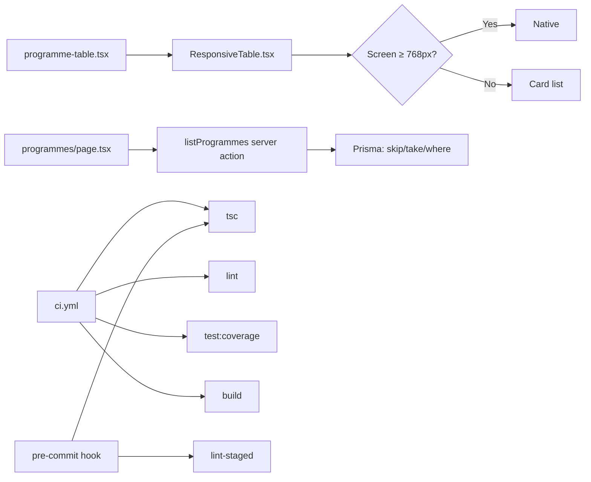

# Requirements

### Overview & Goals
This plan delivers three workstreams:
1. **Phase 6A — Mobile fixes** so every route is usable on real mobile devices (no horizontal scroll, 44px tap targets, no iOS zoom on input focus).
2. **Enhanced admin programmes table** with server-side search, filters, and pagination — replacing the current basic table that shows "none" when empty.
3. **Developer Experience (Phase 7)** — Vitest unit tests, GitHub Actions CI pipeline, and husky pre-commit hooks to make future changes safe.

### User Stories
- As a mobile user, I want tables to display as cards on my phone so I can read admin data without horizontal scrolling.
- As a mobile user, I want form inputs to not trigger zoom when I tap them on iOS.
- As an admin, I want to search, filter, and paginate programmes so I can find what I need quickly.
- As a tutor, I want a clear empty state with a CTA when no programmes exist, so I know what to do next.
- As a developer, I want tests and CI to run automatically so I don't break production.

### Functional Requirements

**Mobile Fixes (6A)**
- Tables with >4 columns render as card lists under 768px
- All inputs use `font-size: 16px` on mobile (prevents iOS zoom)
- All icon-only buttons are at least 44×44px on mobile
- Main content not hidden behind sticky headers
- ProgrammeTreeClient course tables also responsive

**Enhanced Programmes Table**
- Search bar (searches by name, code, shortName)
- Institution filter dropdown
- Pagination (e.g., 10 per page with prev/next)
- Empty state: "No programmes match your filters" with "Clear filters" CTA
- Server-side filtering via Prisma (skip/take)

**Developer Experience (Phase 7)**
- Vitest with jsdom, 70% coverage threshold on critical files
- Unit tests for: auth, programme-crud, programme-tree, tutor-crud
- GitHub Actions CI: tsc + lint + test + build on every push/PR
- Husky pre-commit: ESLint --fix, Prettier, tsc --noEmit
- TypeScript strict flags enabled incrementally

### Non-Functional Requirements
- Do NOT break existing behavior
- Run `tsc + lint + build` after each stage
- Mobile Lighthouse score target: ≥85 Performance, ≥90 Accessibility

### Out of Scope
- Phase 6B (full accessibility audit — aria labels, contrast, screen readers)
- Phase 6C (empty states for all pages — only programmes page gets one)
- Full TypeScript strict mode (`noUncheckedIndexedAccess` skipped — too many errors)
- Integration tests with test database (Phase 7A advanced)
- CodeQL security scan
- Commitlint

# Technical Design

### Current Implementation

**Mobile State:**
- `app/globals.css` has no mobile-safe input font-size rule → iOS zooms on input focus
- `app/(dashboard)/admin/programmes/_components/programme-table.tsx` renders a 6-column `<table>` with no responsive fallback → horizontal scroll on mobile
- `app/(dashboard)/admin/programmes/[id]/ProgrammeTreeClient.tsx` renders per-level course tables — also not responsive
- Icon buttons (e.g., delete, more menu) use `p-1` padding (~24×24px) — below 44px minimum
- `components/DashboardLayout.tsx` has a sticky header; main content may overlap

**Programmes Table:**
- `lib/actions/programme-crud.ts` — `listProgrammes()` supports `institutionId` and `search` filters but no pagination
- `app/(dashboard)/admin/programmes/page.tsx` — simple server page, fetches all programmes, no client-side interactivity
- `programme-table.tsx` — client component with delete confirmation, but no search/filter UI
- Empty state exists (lines 55-67) but is basic — no CTA

**Testing & CI:**
- No test framework installed
- No test files exist
- Existing GitHub workflows (`npm-publish.yml`, `webpack.yml`) are templates — not functional CI
- No husky/lint-staged
- `tsconfig.json` has `strict: true` but missing: `noImplicitReturns`, `noUnusedLocals`, `noUnusedParameters`, `noUncheckedIndexedAccess`

### Key Decisions

1. **Responsive table wrapper** — Create `components/responsive-table.tsx` as a reusable component that accepts column definitions and row data. Renders `<table>` on `md:` and `<Card>` list below. Applied to programmes and ProgrammeTreeClient.

2. **Server-side pagination** — Programmes filtering uses Prisma `skip`/`take` instead of client-side. Keeps payloads small and scales to thousands of programmes.

3. **Vitest over Jest** — Faster, native ESM support, better TypeScript integration. Matches the Next.js 16 ecosystem.

4. **Mock-heavy unit tests** — Prisma, Clerk auth, and Next.js headers are mocked. Tests focus on business logic (validation, role checks, schema parsing) not database integration.

5. **Incremental TypeScript strictness** — Enable one flag at a time, fix errors, then move to the next. Avoid `@ts-ignore`.

### Proposed Changes

#### Stage 1: Mobile Fixes

**New file: `components/responsive-table.tsx`**
```
interface ResponsiveTableProps<C, R> {
  columns: {
    key: keyof R;
    header: string;
    render?: (row: R) => React.ReactNode;
  }[];
  rows: R[];
  emptyMessage?: string;
  children?: React.ReactNode;  // for actions column
}
```
- On `md:` screens: renders native `<table>` with `<thead>`/`<tbody>`
- Below `md:`: renders a `<Card>` per row with key-value pairs
- Hidden on each breakpoint via `hidden md:table` / `block md:hidden`

**Modified: `app/globals.css`**
- Add mobile-safe input rule:
```css
input, textarea, select {
  font-size: 16px;
}
@media (min-width: 768px) {
  input, textarea, select {
    font-size: 14px;
  }
}
```

**Modified: `components/DashboardLayout.tsx`**
- Add `pt-16 md:pt-20` to main content wrapper

**Modified: `programme-table.tsx`**
- Wrap existing table in `ResponsiveTable`
- Bump icon button sizes to `h-11 w-11 md:h-10 md:w-10`

**Modified: `ProgrammeTreeClient.tsx`**
- Wrap per-level course tables in `ResponsiveTable`
- Bump delete button to 44px on mobile

#### Stage 2: Enhanced Programmes Table

**Modified: `lib/actions/programme-crud.ts`**
- Extend `listProgrammes` params:
```ts
export async function listProgrammes(options?: {
  institutionId?: string;
  search?: string;
  page?: number;        // default 1
  pageSize?: number;    // default 10
})
```
- Return `{ programmes: ProgrammeRow[], total: number, page: number, pageSize: number }`
- Use Prisma `skip: (page - 1) * pageSize`, `take: pageSize`

**Modified: `app/(dashboard)/admin/programmes/page.tsx`**
- Accept search/institution/page query params
- Pass to `listProgrammes()`
- Render search input, institution dropdown, and pagination

**Modified: `programme-table.tsx`**
- Accept pagination metadata
- Show "Page X of Y" with prev/next buttons
- Empty state: "No programmes match your filters" + "Clear filters" link

#### Stage 3: Vitest + Unit Tests

**New: `vitest.config.ts`** — jsdom, path aliases, coverage thresholds
**New: `vitest.setup.ts`** — mocks for Clerk, Next.js headers
**New: `lib/__tests__/auth.test.ts`** — requireAuth role checks
**New: `lib/__tests__/programme-crud.test.ts`** — schema validation, code uniqueness
**New: `lib/__tests__/programme-tree.test.ts`** — addCourse validation, bulkAdd parsing
**New: `lib/__tests__/tutor-crud.test.ts`** — role checks, validation

#### Stage 4: CI Pipeline + Husky

**New: `.github/workflows/ci.yml`** — PostgreSQL service, full pipeline
**New: `.github/dependabot.yml`** — weekly npm, monthly actions
**New: `.husky/pre-commit`** — lint-staged + tsc
**Modified: `package.json`** — lint-staged config, test scripts
**Modified: `tsconfig.json`** — add strict flags incrementally

### Architecture Diagram



### Risks
- **ResponsiveTable genericity**: Making it work for both programmes (6 cols) and ProgrammeTreeClient (4 cols) requires a flexible column definition API. Risk of over-engineering. Mitigation: Start with programmes-specific props, generalize later.
- **Vitest Prisma mocking**: Prisma client is a singleton imported via `lib/prisma.ts`. Mocking it cleanly requires careful setup. Mitigation: Use `vi.mock()` at the top of each test file.
- **TypeScript strict flags**: `noUnusedLocals` may produce 50+ errors. Mitigation: Enable one flag, fix all errors, commit, then next flag.

# Delivery Steps

### ✓ Step 1: Phase 6A: Mobile fixes across all routes
Make every admin and student route usable on mobile devices. This includes responsive table-to-card conversion, mobile-safe input sizing, 44px tap targets, and sticky header fixes.
- Create `components/responsive-table.tsx` — a wrapper that renders `<table>` on md+ screens and `<Card>` list on smaller screens.
- Apply responsive-table to: `/admin/programmes` (6-column table), `/admin/courses`, and any other admin tables.
- Add mobile-safe input font-size to `app/globals.css`: `input, textarea, select { font-size: 16px; }` with `@media (min-width: 768px)` reverting to 14px.
- Audit all icon-only buttons across admin pages and ensure `min-h-[44px] min-w-[44px]` on mobile.
- Fix sticky header overlap in `components/DashboardLayout.tsx` by adding `pt-16 md:pt-20` to main content.
- Verify: `npx tsc --noEmit`, `npm run lint`, `npm run build`.

### ✓ Step 2: Enhanced admin programmes table with search, filters, pagination
Transform the programmes admin page into a full-featured admin table with server-side filtering and pagination.
- Update `lib/actions/programme-crud.ts` — add `listProgrammes` to support pagination (`page`, `pageSize`), search (by name/code), and filters (institution, faculty).
- Update `app/(dashboard)/admin/programmes/page.tsx` — add search input, institution filter dropdown, and pagination controls.
- Update `programme-table.tsx` — accept filtered/paginated data; show total count with pagination info.
- Add responsive card layout (from Stage 1's responsive-table wrapper) for mobile view.
- Improve empty state: show "No programmes match your filters" with "Clear filters" CTA when search/filter returns no results.
- Verify: `npx tsc --noEmit`, `npm run lint`, `npm run build`.

### ✓ Step 3: Vitest setup + unit tests for critical lib/ files
Set up Vitest and write unit tests for the core business logic in lib/ to enable safe refactoring.
- Install: `vitest`, `@vitejs/plugin-react`, `jsdom`, `@testing-library/react`, `@testing-library/jest-dom`.
- Create `vitest.config.ts` with jsdom environment, path aliases, and coverage thresholds (70% lines, 70% functions, 60% branches).
- Create `vitest.setup.ts` with mocks for `next/headers`, `@clerk/nextjs/server`, and Prisma.
- Add test scripts to `package.json`: `test`, `test:watch`, `test:coverage`.
- Write tests for: `lib/auth.ts` (requireAuth, role checks), `lib/actions/programme-crud.ts` (Zod schema validation, code uniqueness), `lib/actions/programme-tree.ts` (addCourse validation, bulkAdd parsing), `lib/actions/tutor-crud.ts` (role checks, validation).
- Target: 20+ test cases covering happy paths, validation failures, and auth guards.
- Verify: `npm run test:coverage` passes with ≥70% coverage on tested files.

### ✓ Step 4: GitHub Actions CI pipeline + husky pre-commit
Set up full CI pipeline and local pre-commit hooks to catch issues before they reach GitHub.
- Create `.github/workflows/ci.yml` with: PostgreSQL service, `npm ci`, `prisma generate`, `prisma migrate deploy`, `tsc --noEmit`, `npm run lint`, `npm run test:coverage`, `npm run build`.
- Add concurrency group to cancel in-progress runs on new pushes.
- Create `.github/dependabot.yml` for weekly npm updates and monthly GitHub Actions updates.
- Install and configure `husky` + `lint-staged`: pre-commit runs ESLint --fix, Prettier --write, and `tsc --noEmit` on staged files.
- Add TypeScript strict flags one at a time: `noImplicitReturns`, `noFallthroughCasesInSwitch`, `noUnusedLocals`, `noUnusedParameters` — fixing errors between each.
- Verify: push a test commit, confirm CI passes end-to-end.