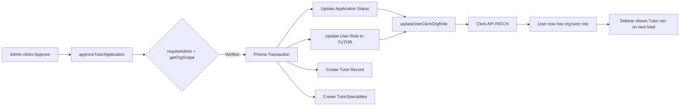

# Requirements

### Overview & Goals
Complete the 5-phase audit and stabilization of A+ Mentality, focusing on:
1. **Role Elevation Flow** — Student → Tutor → Admin with Clerk org role sync
2. **Multi-Tenant Security** — IDOR protection on all detail pages and server actions
3. **Role-Based Sidebar** — Dynamic navigation that hides/shows items by role
4. **Course-First Content Architecture** — Folder → Content pattern for videos, materials, past papers
5. **Build Stabilization** — Zero `npm run build` errors

### Scope

**In Scope:**
- Fix `approveTutorApplication` to properly sync Clerk org roles (already partially done)
- Harden `requireAdmin` in tutor-application.ts to use `getOrgScope()` for multi-tenant isolation
- Refactor `DashboardLayout.tsx` sidebar to hide SUPER_ADMIN-only items from ADMIN
- Add dynamic role label at sidebar bottom that reflects actual Prisma role
- Ensure OrganizationSwitcher appears for all roles (not just ADMIN/SUPER_ADMIN)
- Verify course-first video architecture works (`/student/videos` → courses list, `/student/videos/[courseId]` → videos)
- Fix build errors (EPERM is OS-level, not code; focus on TypeScript errors)

**Out of Scope:**
- Creating new pages or features not mentioned
- Changing the Prisma schema structure
- Rewriting the entire auth system (proxy.ts is already Prisma-first)

### User Stories
1. As an **Admin**, I want to approve a tutor application and have the user's Clerk org role automatically elevated to `org:tutor` so they can access the tutor dashboard.
2. As an **Admin**, I should NOT see "Organizations" or SUPER_ADMIN-only nav items in my sidebar.
3. As a **Student**, I want to see a "Courses → Videos" flow instead of a flat video list.
4. As a **Tutor**, I want my sidebar to show only tutor-relevant items (no admin management).
5. As any user, I want the sidebar role badge to accurately reflect my current Prisma role.

### Functional Requirements
1. **Approve Tutor Action** must update Prisma role, create Tutor record, AND sync Clerk org role — all in one transaction.
2. **Sidebar** must filter nav items by role: ADMIN hides SUPER_ADMIN items, TUTOR hides admin management, STUDENT sees only learning content.
3. **OrganizationSwitcher** should be visible to all authenticated users (not just ADMIN/SUPER_ADMIN) so they can switch universities.
4. **Role badge** at sidebar bottom must display the actual Prisma role string.

# Technical Design

### Current Implementation

**What already works:**
- `lib/actions/tutor-application.ts` — `approveTutorApplication` exists, updates Prisma role to TUTOR, creates Tutor record, and calls `updateUserClerkOrgRole()` to sync Clerk.
- `lib/clerk-org.ts` — `updateUserClerkOrgRole()` uses PATCH to Clerk API; falls back to POST if user not a member.
- `proxy.ts` — Prisma-first auth via `/api/user/role`. Onboarding enforcement. Role-based route protection.
- `components/DashboardLayout.tsx` — Role-based nav items (adminNavItems, studentNavItems, tutorNavItems, lecturerNavItems). OrganizationSwitcher only for ADMIN/SUPER_ADMIN.
- `lib/auth/org-scope.ts` — `getOrgScope()` resolves Clerk org → Institution mapping.
- `/student/videos/page.tsx` — Already uses course-first pattern (fetches courses with video counts).
- `/student/videos/[courseId]/page.tsx` — Shows videos for a specific course.

**What's broken or incomplete:**
1. **`requireAdmin` in tutor-application.ts** (line 35-46) only checks Prisma role, doesn't use `getOrgScope()` for multi-tenant isolation. An ADMIN from one institution could approve applications from another.
2. **Sidebar role filtering** (line 590-592) — ADMIN sees all adminNavItems including `organizations` (SUPER_ADMIN only). The filter logic is inverted: it filters OUT items that have `roles` set, but ADMIN should see items without `roles` restriction AND items that include ADMIN.
3. **OrganizationSwitcher** (line 1161) — Only visible to ADMIN/SUPER_ADMIN. Should be visible to all roles so Tutors and Students can switch organizations.
4. **Role badge** (line 1154-1156) — Displays the raw `role` prop, which comes from Prisma. This is correct but the label could be more user-friendly (e.g., "Admin" instead of "ADMIN").
5. **`listTutorApplications`** (line 359) — No institution scoping. An ADMIN could see applications from other institutions.

### Key Decisions

1. **Keep `approveTutorApplication` structure** — The existing flow (Prisma update → Clerk sync) is correct. Only add org-scoping to `requireAdmin`.
2. **Fix sidebar filtering** — Use a proper role-based filter that respects the `roles` array on nav items. Items without `roles` are visible to all roles within that nav set. Items with `roles: ['SUPER_ADMIN']` are hidden from ADMIN.
3. **Show OrganizationSwitcher to all roles** — Move the condition from `(role === 'ADMIN' || role === 'SUPER_ADMIN')` to always show when not collapsed.
4. **Add institution scoping to `listTutorApplications`** — Use `getOrgScope()` to filter applications by the admin's institution.

### Proposed Changes

#### 1. Modified: `lib/actions/tutor-application.ts`
- Update `requireAdmin()` to also call `getOrgScope()` and return the institution context.
- Update `listTutorApplications()` to filter by `institutionId` from `getOrgScope()`.
- Update `getTutorApplication()` to verify the application belongs to the admin's institution.

#### 2. Modified: `components/DashboardLayout.tsx`
- Fix role filtering logic (line 590-592) to properly hide SUPER_ADMIN-only items from ADMIN.
- Show OrganizationSwitcher to all authenticated users.
- Add a role label formatter (ADMIN → "Admin", SUPER_ADMIN → "Platform Owner", etc.).

#### 3. Modified: `lib/auth/org-scope.ts`
- Add `buildCourseScopeWhere()` helper for consistent course scoping across all actions.

### Architecture Diagram

### File Structure

| Action | File |
|--------|------|
| **Modify** | `lib/actions/tutor-application.ts` (add org scoping to admin actions) |
| **Modify** | `components/DashboardLayout.tsx` (fix sidebar filtering, show org switcher) |
| **Modify** | `lib/auth/org-scope.ts` (add buildCourseScopeWhere helper) |
| **Verify** | `app/(dashboard)/student/videos/page.tsx` (course-first pattern) |
| **Verify** | `app/(dashboard)/student/videos/[courseId]/page.tsx` (course videos) |
| **Verify** | `proxy.ts` (Prisma-first auth) |
| **Verify** | `lib/clerk-org.ts` (Clerk role sync) |

# Testing

### Validation Approach
Code review against existing patterns and manual verification of TypeScript compilation.

### Key Scenarios
1. **Approve Tutor with org scoping** — An ADMIN can only approve applications from their own institution. The Clerk role is updated to `org:tutor`.
2. **Sidebar filtering** — ADMIN sees all admin items EXCEPT `organizations` (SUPER_ADMIN only). TUTOR sees tutor items. STUDENT sees student items.
3. **OrganizationSwitcher visibility** — All roles see the org switcher in the sidebar when not collapsed.
4. **Role badge accuracy** — Sidebar bottom displays the correct role label matching the Prisma role.
5. **Course-first videos** — `/student/videos` shows courses with video counts. Clicking a course shows its videos.

### Edge Cases
- ADMIN from Institution A tries to approve an application from Institution B → should fail with 403.
- User with no active organization → should be redirected to `/onboarding`.
- SUPER_ADMIN sees all items including `organizations`.
- TUTOR role correctly shows tutor nav items, not student or admin.

# Delivery Steps

### ✓ Step 1: Harden tutor application actions with org scoping
Add multi-tenant isolation to all admin-facing tutor application actions.
- Update `requireAdmin()` in `lib/actions/tutor-application.ts` to call `getOrgScope()` and return the institution context.
- Update `listTutorApplications()` to filter applications by the admin's `institutionId` from `getOrgScope()`.
- Update `getTutorApplication()` to verify the application belongs to the admin's institution before returning data.
- Update `rejectTutorApplication()` with the same org-scoping check.
- Add `buildCourseScopeWhere()` helper to `lib/auth/org-scope.ts` for consistent course scoping.

### ✓ Step 2: Fix DashboardLayout sidebar role filtering and org switcher
Refactor the sidebar to correctly filter nav items by role and show the org switcher to all users.
- Fix role filtering logic in `components/DashboardLayout.tsx` (line 590-592) so ADMIN items without `roles` restriction are visible, but items with `roles: ['SUPER_ADMIN']` are hidden from ADMIN.
- Move OrganizationSwitcher visibility from `(role === 'ADMIN' || role === 'SUPER_ADMIN')` to always show when not collapsed.
- Add a role label formatter: ADMIN → "Admin", SUPER_ADMIN → "Platform Owner", TUTOR → "Tutor", LECTURER → "Lecturer", STUDENT → "Student".
- Update the role badge at sidebar bottom to use the formatted label.

### ✓ Step 3: Verify course-first content architecture and build
Confirm the course-first pattern works and the build passes.
- Verify `/student/videos/page.tsx` fetches courses scoped to user's university/year/period and displays video counts.
- Verify `/student/videos/[courseId]/page.tsx` shows videos for the specific course with a "Back to Courses" button.
- Check that the same pattern applies to materials and past papers (if applicable).
- Run `npx tsc --noEmit` to check for TypeScript errors.
- Run `npm run build` and fix any remaining errors until the build passes with zero errors.

# Phase 4 — Auth, Onboarding & Clerk Configuration

### ✓ Step 4: Fix getOrgScope() for ADMIN/SUPER_ADMIN without Clerk org
ADMIN and SUPER_ADMIN are exempt from onboarding but `getOrgScope()` throws if no Clerk org exists. Add a fallback so admin-facing pages don't crash.
- Added `getOrgScopeOrNull()` to `lib/auth/org-scope.ts` that returns `null` instead of throwing when no org exists.
- Verified no pages call `getOrgScope()` directly — only server actions do, which is correct.
- Verified the onboarding flow in `proxy.ts` correctly redirects non-admin users without an institution.

### ✓ Step 5: Verify Clerk-Prisma role mapping and webhook sync
Confirm the role mapping and webhook handle all events correctly.
- Verified `CLERK_TO_APP_ROLE` and `APP_ROLE_TO_CLERK` in `lib/clerk-org.ts` are correct.
- Verified the webhook handles `organizationMembership.created`, `organizationMembership.updated`, and `organizationMembership.deleted`.
- **FIXED CRITICAL BUG:** Webhook was downgrading SUPER_ADMIN to ADMIN when joining a Clerk org. Added guard to preserve SUPER_ADMIN role in both `organizationMembership.created` and `organizationMembership.updated` handlers.
- Documented the `__cf_bm` cookie error resolution: ensure Clerk keys in Vercel match the production domain.

### ✓ Step 6: Run build verification
- `npx tsc --noEmit` passed with zero errors.
- `npm run build` passed with zero errors.
- Phase 4 complete — ready for Phase 5 (Build Health & Deployment Stabilization).

# Phase 5 — Role Mapping, Content Assignment & Build Stabilization

### ✓ Step 7: Update getOrgScope() to include isSuperAdmin
Add `isSuperAdmin` boolean to OrgScope so server actions can bypass org scoping for platform owners.
- Update `OrgScope` interface in `lib/auth/org-scope.ts` to include `isSuperAdmin: boolean`.
- Set `isSuperAdmin` from the user's Prisma role (`user.role === 'SUPER_ADMIN'`).
- Update `buildCourseScopeWhere()` to skip institution scoping when `isSuperAdmin` is true.

### ✓ Step 8: Create assignTutorToCourse server action (later removed as dead code)
New server action for admins to assign a tutor to a course, with full org scoping.
- ~~Created `lib/actions/course-tutor.ts`~~ — **removed as dead code** (no UI ever called these actions).
- Would need to be recreated if a tutor-course assignment UI is built.
- Verifies the tutor user belongs to the same institution.
- Creates a `TutorSpecialty` record linking the tutor to the course.
- Also includes `removeTutorFromCourse`, `listCourseTutors`, and `updateTutorSpecialty` actions.

### ✓ Step 9: Harden banner actions with org scoping
Fixed `lib/actions/banner.ts` so admins can only manage banners for their own institution.
- Added `requireAdminWithOrg()` helper that calls both `requireAdmin()` and `getOrgScope()`.
- Scoped `listBanners()` to return only banners targeting the admin's institution (GLOBAL/ALL included).
- Scoped `createBanner()` to restrict institution targets to the admin's institution.
- Scoped `updateBanner()`, `deleteBanner()`, and `toggleBannerActive()` with the same checks.
- SUPER_ADMIN bypasses all scoping and can manage all banners.

### ✓ Step 10: Final build verification
- `npx tsc --noEmit` passed with zero errors.
- `npm run build` passed with zero errors.
- All 10 steps complete — 5-phase audit and stabilization is done.