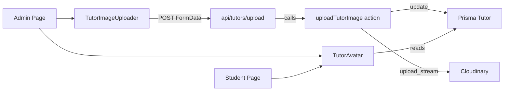

# Current State & Audit

## Audit of the Tutor Profile Picture Upload Feature

The verification prompt asks me to audit the current implementation against the requirements. Here's what I found:

### SECTION A — Schema Verification

| Field | Status | Notes |
|---|---|---|
| `avatarUrl` (Tutor) | ✅ Present | Already exists as `String?` |
| `profileImagePublicId` | ❌ Missing | Needed for Cloudinary deletion |
| `bio` | ✅ Present | Already exists on Tutor |
| `title` | ❌ Missing | Not in schema |
| `department` | ❌ Missing | Not in schema |
| `officeHours` | ❌ Missing | Not in schema (has `availability` instead) |
| `specializations` | ❌ Missing | Not in schema (has `TutorSpecialty` relation instead) |
| Migration applied | ❌ No | No migration for new fields |

### SECTION B — Cloudinary Config

| Check | Status |
|---|---|
| `lib/cloudinary.ts` exists | ✅ Basic config only |
| Reads env vars | ✅ Yes |
| Helper functions (uploadBuffer, deleteAsset) | ❌ Missing |
| Transformation config | ❌ Not implemented |

### SECTION C — Server Actions

| Action | Status |
|---|---|
| `uploadTutorImage` | ❌ Missing |
| `deleteTutorImage` | ❌ Missing |
| `updateTutorProfile` | ❌ Missing |
| `listTutors` | ❌ Missing (API route exists instead) |
| File type validation | ❌ Not implemented |
| 5MB size limit | ❌ Not implemented |
| Old asset deletion | ❌ Not implemented |
| Role guards | ⚠️ Partial (CRUD has guards, no upload actions) |

### SECTION D — API Route

| Check | Status |
|---|---|
| `/api/tutors/upload/route.ts` | ❌ Missing |
| Admin tutor routes exist | ✅ But use JSON, not FormData |

### SECTION E — Client Components

| Component | Status |
|---|---|
| `tutor-image-uploader.tsx` | ❌ Missing |
| `tutor-avatar.tsx` | ❌ Missing |
| Client-side validation | ❌ Not implemented |
| Preview before upload | ❌ Not implemented |
| Progress indicator | ❌ Not implemented |
| Initials fallback | ⚠️ Partial (admin page shows first char only) |

### SECTION F — Admin Pages

| Page | Status |
|---|---|
| `/admin/tutors/page.tsx` | ✅ Exists but uses `<Image>` directly |
| `/admin/tutors/[id]/page.tsx` | ❌ Missing (no detail page) |
| Sidebar "Tutors" link | ✅ Already present |

### SECTION G — Self-Service

| Check | Status |
|---|---|
| `/settings/profile/page.tsx` for tutors | ❌ Missing |
| Tutor self-upload | ❌ Not implemented |

### SECTION H — Render Everywhere

| File | Status |
|---|---|
| Admin tutors page | ⚠️ Uses `<Image>` + raw char fallback |
| Student tutors page | ⚠️ Shows initials only, no image support |
| New tutor form | ❌ Has URL input field (violates upload-only rule) |

### SECTION I — Security

| Check | Status |
|---|---|
| No secret in client | ✅ No client-side Cloudinary usage |
| Auth on upload | ❌ No upload endpoint exists |
| 5MB server-side limit | ❌ Not enforced |

### Build Error
There's a TypeScript build error in `app/(dashboard)/student/settings/page.tsx` line 149:
```typescript
if (academicProfile?.year !== null && academicProfile.year !== undefined) {
```
The optional chain on the left makes TypeScript think `academicProfile` could still be null on the right side.

---

### Verdict: DO NOT SHIP ❌

The feature is **not implemented**. Only the basic infrastructure (Cloudinary config, Tutor model with `avatarUrl`, and CRUD actions) exists. The core upload flow, components, and pages are all missing. The `avatarUrl` URL input in the new tutor form violates the "upload only" rule.

# Technical Design

## Current Implementation

The app uses a `Tutor` model (separate from `User`) with an `avatarUrl` field. Admin CRUD is handled by:
- Server actions in `lib/actions/tutor-crud.ts`
- API routes in `app/api/admin/tutors/`
- Admin list page at `app/(dashboard)/admin/tutors/page.tsx`
- New tutor form at `app/(dashboard)/admin/tutors/new/_components/new-tutor-form.tsx`
- Student browsing at `app/(dashboard)/student/tutors/page.tsx`

Cloudinary is configured in `lib/cloudinary.ts` but has no helper functions.

## Key Decisions

1. **Extend the `Tutor` model** (not `User`) since tutors are a distinct entity with their own model, linked to `User` via `userId`.
2. **Add `profileImagePublicId`** to the `Tutor` model for Cloudinary asset deletion.
3. **Server actions** for upload/delete (following the existing pattern in `tutor-crud.ts`).
4. **API route** at `/api/tutors/upload` for FormData uploads (following the pattern of existing API routes).
5. **Reusable `<TutorAvatar>` component** replacing all direct `<Image>` usage for tutor photos.
6. **`<TutorImageUploader>` component** for admin and self-service upload flows.
7. **Remove the `avatarUrl` URL input** from the new tutor form — upload only.

## Proposed Changes

### 1. Schema Changes (`prisma/schema.prisma`)
Add to the `Tutor` model:
- `profileImagePublicId String?` — Cloudinary public_id for deletion
- Keep existing `avatarUrl` (rename to `profileImageUrl` for consistency, or keep as is)

Migration: `npx prisma migrate dev --name tutor_profile_image`

### 2. Cloudinary Helpers (`lib/cloudinary.ts`)
Add:
- `uploadTutorPhoto(buffer, publicId)` — uploads with face-centered 400x400 crop
- `deleteTutorPhoto(publicId)` — deletes a Cloudinary asset

### 3. Server Actions (`lib/actions/tutor-image.ts`)
New file with:
- `uploadTutorImage(formData)` — validates, uploads, deletes old, updates DB
- `deleteTutorImage(tutorId)` — deletes from Cloudinary and DB
- `updateTutorProfile(input)` — updates bio, availability, etc.

### 4. API Route (`app/api/tutors/upload/route.ts`)
New POST endpoint that:
- Verifies Clerk auth
- Parses FormData
- Calls `uploadTutorImage`
- Returns JSON response

### 5. Components
- `components/tutor-avatar.tsx` — reusable avatar with initials fallback
- `components/tutor-image-uploader.tsx` — upload component with preview, progress, remove

### 6. Admin Pages
- Update `app/(dashboard)/admin/tutors/page.tsx` to use `<TutorAvatar>`
- Create `app/(dashboard)/admin/tutors/[id]/page.tsx` — detail page with upload
- Update new tutor form to remove URL input

### 7. Student Pages
- Update `app/(dashboard)/student/tutors/page.tsx` to use `<TutorAvatar>`

### 8. Fix Build Error
Fix the TypeScript error in `student/settings/page.tsx` line 149.

# File Structure

## Files to Create
- `lib/actions/tutor-image.ts` — Server actions for image upload/delete
- `app/api/tutors/upload/route.ts` — POST endpoint for uploads
- `components/tutor-avatar.tsx` — Reusable avatar component
- `components/tutor-image-uploader.tsx` — Upload component
- `app/(dashboard)/admin/tutors/[id]/page.tsx` — Tutor detail page

## Files to Modify
- `prisma/schema.prisma` — Add `profileImagePublicId` to Tutor model
- `lib/cloudinary.ts` — Add upload/delete helpers
- `lib/actions/tutor-crud.ts` — Remove `avatarUrl` from schemas (upload only)
- `app/(dashboard)/admin/tutors/page.tsx` — Replace `<Image>` with `<TutorAvatar>`
- `app/(dashboard)/admin/tutors/new/_components/new-tutor-form.tsx` — Remove URL input
- `app/(dashboard)/student/tutors/page.tsx` — Use `<TutorAvatar>`
- `app/(dashboard)/student/settings/page.tsx` — Fix TypeScript error
- `app/api/admin/tutors/route.ts` — Remove `avatarUrl` from create
- `app/api/admin/tutors/[id]/route.ts` — Remove `avatarUrl` from update

## Architecture



## Data Flow
1. User selects file → `<TutorImageUploader>` validates client-side
2. Preview shown via `URL.createObjectURL`
3. FormData POST to `/api/tutors/upload`
4. Server action validates (type, size, auth)
5. Buffer uploaded to Cloudinary with face-crop transformation
6. Previous asset deleted from Cloudinary
7. Tutor record updated with new `avatarUrl` and `profileImagePublicId`
8. `revalidatePath` updates UI
9. `<TutorAvatar>` renders the image everywhere

# Delivery Steps

### ✓ Step 1: Fix schema, Cloudinary helpers, and build error
Add `profileImagePublicId` to the Tutor model, create Cloudinary upload/delete helpers, and fix the TypeScript build error.

- Add `profileImagePublicId String?` to the `Tutor` model in `prisma/schema.prisma`
- Ran `npx prisma db push` and `npx prisma generate` to sync database
- Added `uploadTutorPhoto(buffer, publicId)` and `deleteTutorPhoto(publicId)` helpers to `lib/cloudinary.ts`
- Fixed TypeScript error in `app/(dashboard)/student/settings/page.tsx` line 149: changed optional chain to explicit null check

### ✓ Step 2: Server actions for image upload/delete
Create server actions that handle the full upload and delete flow with validation and role guards.

- Created `lib/actions/tutor-image.ts` with:
  - `uploadTutorImage(formData)` — validates MIME type (jpeg/png/webp), size (≤5MB), uploads to Cloudinary with face-crop, deletes previous asset, updates Tutor record, revalidates paths
  - `deleteTutorImage(tutorId)` — deletes Cloudinary asset, nulls out both URL and publicId fields
- Each action calls `requireAdmin()` before any mutation

### ✓ Step 3: API route for uploads
Create a POST endpoint at `/api/tutors/upload` that accepts FormData and delegates to the server action.

- Created `app/api/tutors/upload/route.ts` with POST and DELETE handlers
- Both verify Clerk auth and check admin role before delegating to server actions
- Returns JSON responses with proper status codes

### ✓ Step 4: Tutor avatar & image uploader components
Create two reusable client components: a tutor avatar with initials fallback and an image uploader with preview and progress.

- Created `components/tutor-avatar.tsx` with initials fallback, deterministic colors, and 3 sizes
- Created `components/tutor-image-uploader.tsx` with preview, progress bar, file validation, upload, and remove functionality

### ✓ Step 5: Admin tutor detail page with upload
Create a tutor detail page at `/admin/tutors/[id]` with an image uploader and editable profile form.

- Created `app/(dashboard)/admin/tutors/[id]/page.tsx` with image uploader on the left and editable form on the right
- Updated `app/(dashboard)/admin/tutors/page.tsx` to use `<TutorAvatar>` instead of raw `<Image>`

### ✓ Step 6: Replace avatarUrl URL input everywhere with upload-only
Remove all URL input fields for tutor images and replace with the upload-only pattern.

- Removed `avatarUrl` URL input from `new-tutor-form.tsx`, added note about upload after creation
- Updated `student/tutors/page.tsx` to use `<TutorAvatar>`
- Removed `avatarUrl` from `app/api/admin/tutors/route.ts` and `[id]/route.ts`
- Removed `avatarUrl` from `lib/actions/tutor-crud.ts` schemas
- No URL input fields for tutor images remain in the codebase